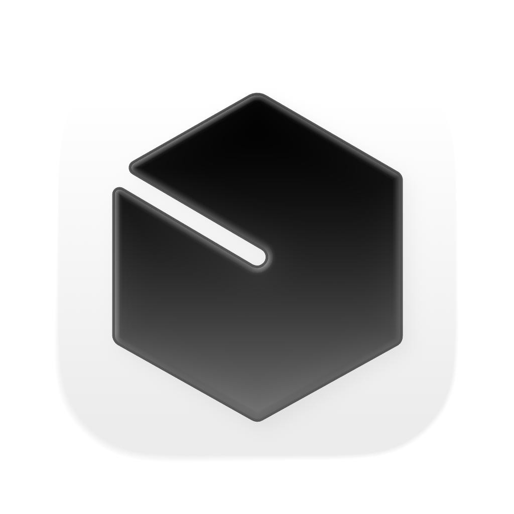
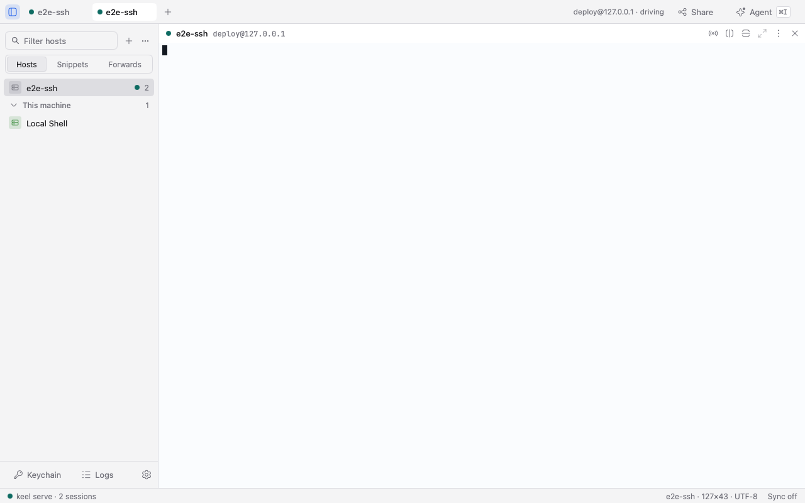
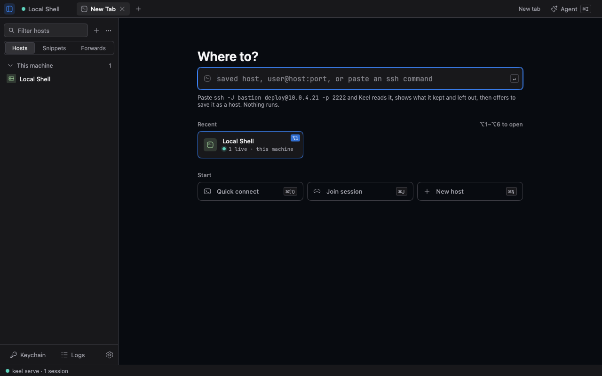

<div align="center">



# Keel

**A local SSH workspace with an encrypted vault, live session sharing, and an agent that asks before it types.**

[](https://github.com/KJK-Nice/keel/actions/workflows/test.yml)


[](LICENSE)



</div>

## Features

- **Native desktop window** ([MyGo](https://github.com/egoist/mygo) and libghostty terminals, no webview). Tabs, splits, a command palette (⌘K) and [keyboard shortcuts](docs/shortcuts.md) for everything.
- **Sessions that survive the window.** PTYs live in `keel serve`; close the window to detach, reopen Keel and your tabs come back.
- **Encrypted vault.** Passwords, private keys and passphrases are encrypted with [age](https://age-encryption.org) and wrapped by the OS keychain. Import hosts from `~/.ssh/config` in one step; your `~/.ssh` is never changed. [More →](docs/vault.md)
- **Share a session over the internet** with WebRTC. Joiners see one terminal, never your hosts or keys, and follow read-only until you hand over control. [More →](docs/sharing.md)
- **Port forwarding**: local, remote and SOCKS5, on and off per forward.
- **Snippets and notebooks**, with approve-before-type: nothing is written to a terminal until you see the bytes and click **Type**.
- **Command marks** for bash, zsh and fish (OSC 133): `keel serve` follows them, so the agent reads a pane's last command and its exit status. [More →](docs/shell-integration.md)
- **Agent (in progress).** Ask about your panes; it reads redacted output, proposes commands, never types on its own, never sees the vault, and logs every read. Claude Code can join in through `keel mcp`, under the same rules, once you allow it in Settings · Agent. [More →](docs/agent.md)

<p align="center">
  
</p>

## Install

Download the latest build from **[Releases](https://github.com/KJK-Nice/keel/releases/latest)**.

What each release holds (file names, platforms, signing) is in [docs/release.md](docs/release.md).

**macOS 13+** (Apple Silicon and Intel): open the `.dmg` and drag **Keel.app** to Applications. Unless the release says it is notarized, macOS blocks the first launch: open **System Settings → Privacy & Security** and click **Open Anyway** next to "Keel was blocked", or run `xattr -dr com.apple.quarantine /Applications/Keel.app`. The `keel` command of the app (`keel serve`, `keel mcp`, `keel version`) is `/Applications/Keel.app/Contents/MacOS/Keel`.

**Linux**, x86_64 (`amd64`) or arm64 (the window is Keel's own, so there is no WebKit to install; it needs GTK 3, and the package carries libghostty-vt beside the binary):

```bash
# Debian, Ubuntu: installs /opt/keel, the `keel` command and a menu entry
sudo apt install ./keel_*_amd64.deb                # or the arm64 one
# any distribution: unpack the .tar.gz into a folder of its own and run keel there
mkdir keel && tar -xzf keel-*-linux-amd64.tar.gz -C keel && ./keel/keel   # or the arm64 one
```

The Linux window has not been run by the maintainer yet (`docs/native.md`). Windows is not supported yet. Each release lists its files' checksums in `SHA256SUMS`; `keel version` prints the version you run.

### Build from source

With Go (the version in `go.mod`):

```bash
git clone https://github.com/KJK-Nice/keel.git && cd keel
make build
./bin/keel            # macOS: or open build/darwin-*/Keel.app (make build packages it)
```

No C toolchain is needed to build; macOS needs the Xcode Command Line Tools (`xcode-select --install`) for `codesign`. Details in [CONTRIBUTING.md](CONTRIBUTING.md).

## Quick start

1. **Open Keel.** The first run creates your vault (in the OS keychain, or with a passphrase) and offers to import the hosts in `~/.ssh/config`.
2. **Connect.** Click a host in the Vault sidebar, or press **⌘T** and type `user@host`, or paste an `ssh …` command (it is parsed, never run).
3. **Split and share.** **⌘⇧D** splits the pane; **Share** in the titlebar gives a link someone else can join.

Close the window whenever you like: sessions keep running in `keel serve` until you close their tab or run `keel serve stop`.

## Documentation

| Guide | What's in it |
|---|---|
| [Vault](docs/vault.md) | Hosts, keychain identities, first run and `~/.ssh/config` import, unlock, port forwarding, logs |
| [Tabs, splits and shortcuts](docs/shortcuts.md) | Every key, the New tab page, the command palette, settings |
| [Sharing](docs/sharing.md) | Share and join, passing control, running `keel-signal`, the security model |
| [Shell integration](docs/shell-integration.md) | OSC 133 snippets for bash, zsh and fish |
| [Agent](docs/agent.md) | The agent panel and its rules |
| [Runtime and configuration](docs/runtime.md) | `keel serve`, environment variables, the loopback API, upgrading |
| [Contributing](CONTRIBUTING.md) | Building, checks, code layout, architecture |

## How it works

Go owns SSH and PTYs in a local daemon, `keel serve`. The window is native ([MyGo](https://github.com/egoist/mygo), pure Go, with [libghostty](https://ghostty.org) terminals) and talks to `keel serve` on a loopback-only, token-protected HTTP server (`docs/native.md`). The daemon serves no web page. Shared sessions travel over WebRTC, so the local API never leaves your machine.

## License

[MIT](LICENSE)
