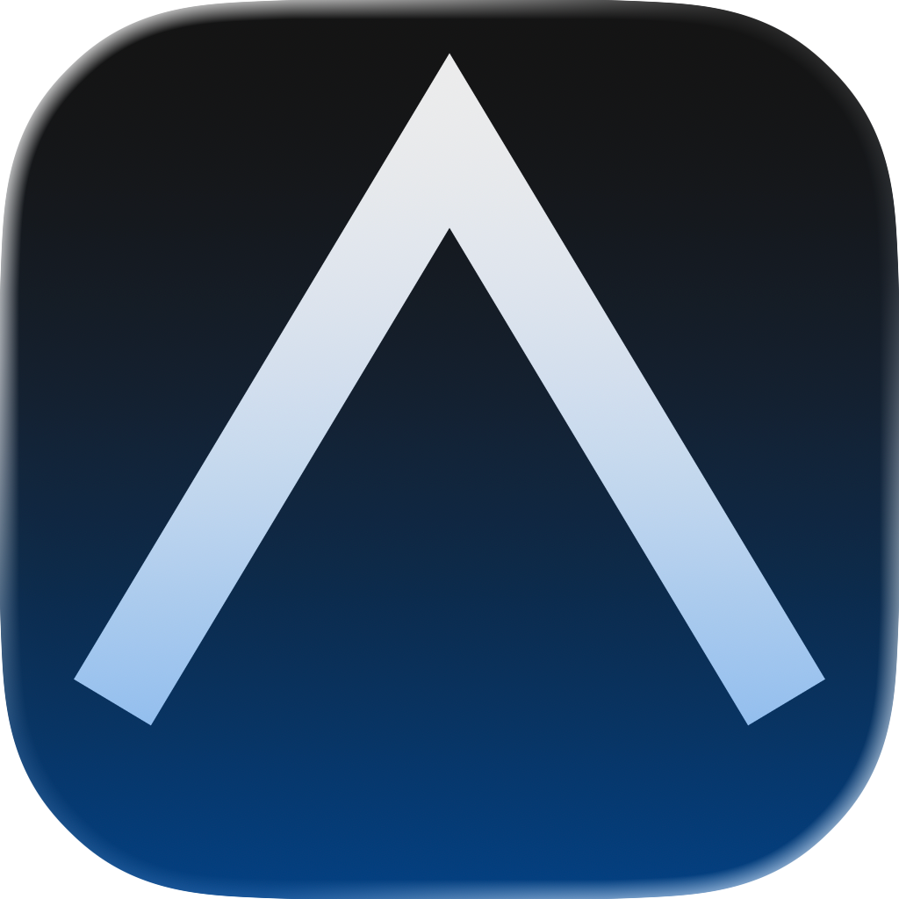
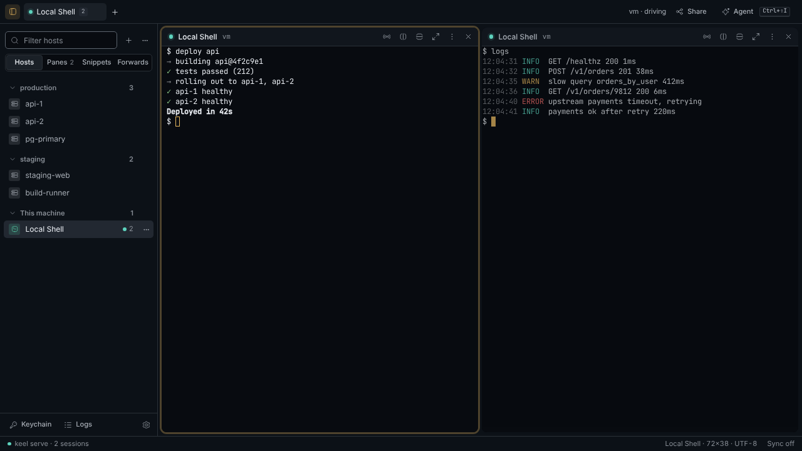
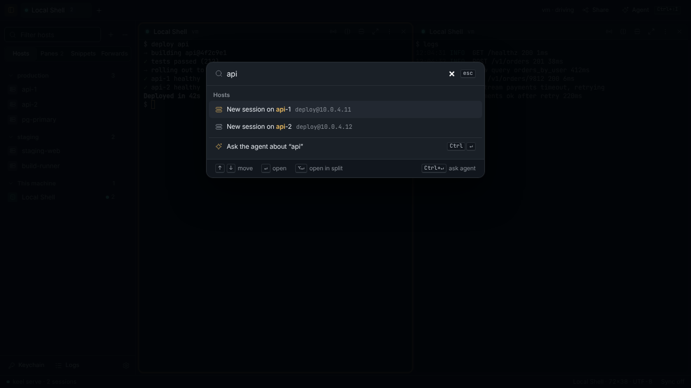
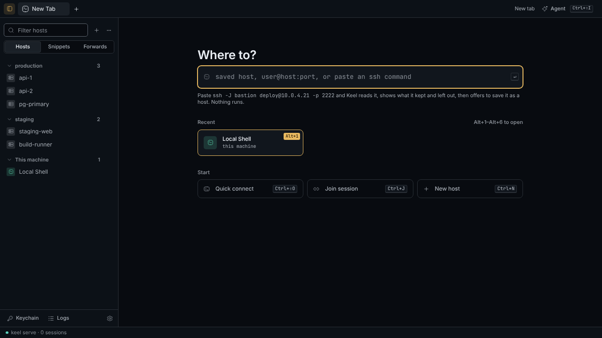

<div align="center">



# Keel

**A local SSH workspace with an encrypted vault, live session sharing, and an agent that asks before it types.**

[](https://github.com/KJK-Nice/keel/actions/workflows/test.yml)


[](LICENSE)

<picture>
  <source media="(prefers-color-scheme: light)" srcset="docs/images/hero-light.png">
  
</picture>

</div>

## Features

- **Native desktop window**: macOS WebKit, Windows WebView2, Linux WebKitGTK. Tabs, splits, a command palette (⌘K) and [keyboard shortcuts](docs/shortcuts.md) for everything.
- **Sessions that survive the window.** PTYs live in `keel serve`; close the window to detach, reopen Keel and your tabs come back.
- **Encrypted vault.** Passwords, private keys and passphrases are encrypted with [age](https://age-encryption.org) and wrapped by the OS keychain. Import hosts from `~/.ssh/config` in one step; your `~/.ssh` is never changed. [More →](docs/vault.md)
- **Share a session over the internet** with WebRTC. Joiners see one terminal, never your hosts or keys, and follow read-only until you hand over control. [More →](docs/sharing.md)
- **Port forwarding**: local, remote and SOCKS5, on and off per forward.
- **Snippets and notebooks**, with approve-before-type: nothing is written to a terminal until you see the bytes and click **Type**.
- **Command marks** for bash, zsh and fish (OSC 133): exit status in the gutter, jump between commands. [More →](docs/shell-integration.md)
- **Agent (in progress).** Ask about your panes; it reads redacted output, proposes commands, never types on its own, never sees the vault, and logs every read. Claude Code can join in through `keel mcp`, under the same rules, once you allow it in Settings · Agent. [More →](docs/agent.md)

<p align="center">
  
  
</p>

## Install

Prebuilt downloads are coming with the first release. Until then, build from source with Go (the version in `go.mod`):

```bash
git clone https://github.com/KJK-Nice/keel.git && cd keel
make build
./bin/keel            # macOS: or open bin/Keel.app
```

Linux needs Ubuntu 24.04+ (or another distro with GTK4 and WebKitGTK 6): `sudo apt install libgtk-4-dev libwebkitgtk-6.0-dev`. macOS needs the Xcode Command Line Tools (`xcode-select --install`). Details in [CONTRIBUTING.md](CONTRIBUTING.md).

## Quick start

1. **Open Keel.** The first run creates your vault (in the OS keychain, or with a passphrase) and offers to import the hosts in `~/.ssh/config`.
2. **Connect.** Click a host in the Vault sidebar, or press **⌘T** and type `user@host`, or paste an `ssh …` command (it is parsed, never run).
3. **Split and share.** **⌘⇧D** splits the pane; **Share** in the titlebar gives a link someone else can join.

Close the window whenever you like: sessions keep running in `keel serve` until you close their tab or run `keel serve stop`.

## Documentation

| Guide | What's in it |
|---|---|
| [Vault](docs/vault.md) | Hosts, keychain identities, first run and `~/.ssh/config` import, unlock, port forwarding, logs |
| [Tabs, splits and shortcuts](docs/shortcuts.md) | Every key, the New tab page, the command palette, settings |
| [Sharing](docs/sharing.md) | Share and join, passing control, running `keel-signal`, the security model |
| [Shell integration](docs/shell-integration.md) | OSC 133 snippets for bash, zsh and fish |
| [Agent](docs/agent.md) | The agent panel and its rules |
| [Runtime and configuration](docs/runtime.md) | `keel serve`, environment variables, the loopback API, upgrading |
| [Contributing](CONTRIBUTING.md) | Building, checks, code layout, architecture |

## How it works

Go owns SSH and PTYs in a local daemon, `keel serve`. The window is a [Wails v3](https://v3.wails.io) webview on a loopback-only, token-protected HTTP server; the UI is [templ](https://templ.guide) + [shadcn-templ](https://shadcn-templ.com) + [Datastar](https://data-star.dev), and terminals are [xterm.js](https://xtermjs.org). Shared sessions travel over WebRTC, so the local API never leaves your machine.

## License

[MIT](LICENSE)
