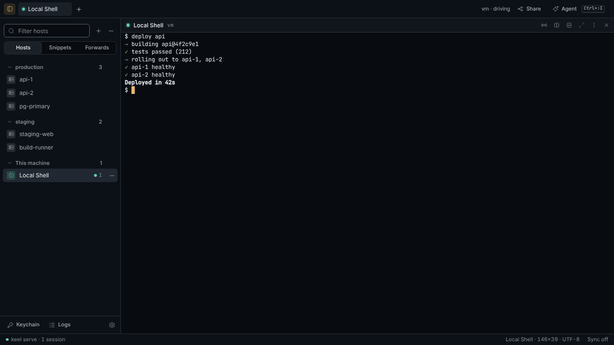

# Vault

The **Vault** is the sidebar on the left of every tab (**⌘B** or the titlebar button folds it). Its filter and segments show **Hosts** (the host tree by group: click a host to connect, the row's menu edits, duplicates or removes it), **Snippets** (click one to type it after you approve; notebooks below) and **Forwards** (on/off per forward). Its footer opens **Keychain**, **Logs** and **Settings**. Keychain, Port forwarding, Snippets, Notebooks, Logs and Settings each open as their own tab page, one of each; opening one again selects its tab.

## Secrets

Secrets (SSH password, private key, key passphrase) are encrypted with [age](https://age-encryption.org). The wrapping key is stored in the OS keychain when possible (macOS Keychain, Windows Credential Manager, libsecret). If that fails, Keel asks for a passphrase on first launch.

**Keychain** is a list of reusable SSH identities (password or private key) you attach to hosts. That is separate from the OS keychain that wraps `keel.vault`.

Existing plaintext `keel.json` files are migrated on unlock: secrets move into `keel.vault` and are stripped from the JSON.

The first time you connect to an SSH host, Keel asks you to trust its key. A different key later is rejected until you replace it.

## First run

A new Keel opens on **Welcome to Keel**: step 1 shows the vault (made in the keychain, or created here with a passphrase when the keychain does not answer; its path and what it holds), step 2, **Bring your hosts**, reads `~/.ssh/config` and lists its hosts with checkboxes.

The config is only read, never written; Include (relative to `~/.ssh`, globs, at most 8 deep, loops cut), Host (several names give several rows), HostName, User, Port and IdentityFile are understood. Wildcard names (`*`, `?`, `!`) are listed as patterns, not hosts; Match blocks are skipped with a note; hosts with ProxyCommand or ProxyJump are flagged and can be added without the proxy (jump hosts are not supported yet); hosts already saved (same address, user and port) start unchecked.

Each private key the hosts name has its own switch, off by default: a key you turn on is copied into the vault as a Keychain identity (asking for its passphrase if it has one, which is stored in the vault too) and the files in `~/.ssh` are never changed, moved or chmod'ed. The same import is in the command palette as **Import hosts from ~/.ssh/config**.

## Unlock

When the vault exists but keel serve could not open it at start, the window shows **Unlock your vault**: the passphrase, how many sessions are waiting in `keel serve` (they keep running while the vault is locked), and a reminder that a lost passphrase cannot be recovered. Keel never creates, re-keys or overwrites a vault from that screen.

## Port forwarding

Saved on the Port forwarding page (Vault sidebar → Forwards → Manage forwards). Local (`-L`), remote (`-R`), and dynamic SOCKS5 (`-D`). Each forward opens its own SSH connection (it does not share a shell session). Default bind is `127.0.0.1`. Binding `0.0.0.0` exposes the port on every interface.

## Logs

Logs (Vault sidebar footer) is an append-only event log (`keel.log` under `KEEL_DATA`). Connect/spawn/kill, tunnel start/stop, and vault unlock are recorded. Secrets are never written.
